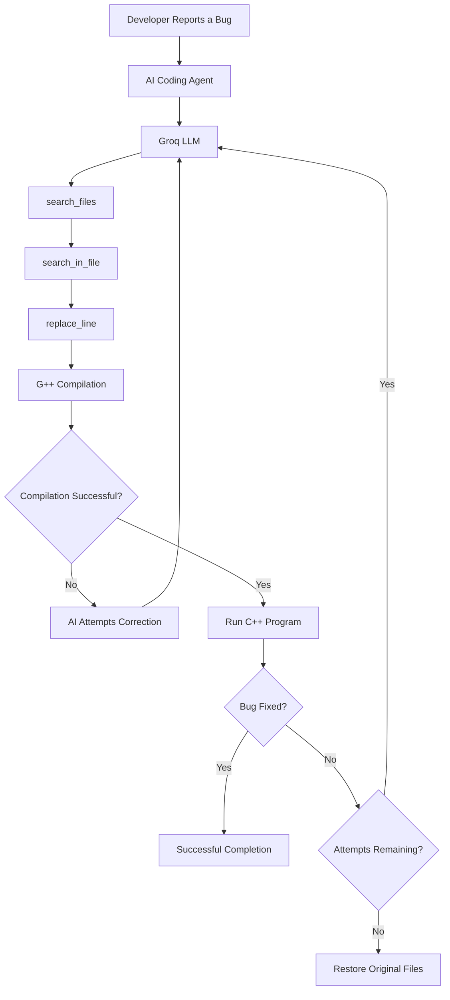

# 🤖 AI Coding Agent

### An AI-powered autonomous debugging assistant for C++ projects

An intelligent, LLM-powered coding agent that analyzes bug reports, explores C++ source code, identifies potential issues, applies targeted code fixes, and verifies the results through compilation and execution.

Built using **Python, Groq API, and AI-powered tool calling**, this project demonstrates how Large Language Models can interact with a real codebase and perform practical software debugging tasks.

---

## 🚀 Overview

The **AI Coding Agent** is designed to simplify the debugging process by automating repetitive code investigation and bug-fixing tasks.

Instead of manually searching through multiple source files, developers can describe a bug in natural language. The agent then analyzes the project, identifies relevant code, makes minimal modifications, and checks whether the updated program compiles successfully.

The system follows an iterative debugging workflow, allowing the AI to refine its solution based on compiler errors and user feedback.

## ✨ Key Features

- **Natural Language Bug Reporting:** Describe coding problems using simple English.
- **AI-Powered Code Analysis:** Uses a Groq-hosted LLM to understand bug reports and identify relevant source files.
- **Intelligent File Search:** Locates C++ files related to the reported issue.
- **Line-Level Code Inspection:** Searches source files and retrieves matching lines with line numbers.
- **Automated Bug Fixing:** Replaces targeted lines of code with AI-generated corrections.
- **Automatic Compilation:** Uses the G++ compiler to verify code changes.
- **Program Execution:** Runs the compiled program and captures its output.
- **Iterative Debugging:** Supports up to three debugging attempts, with up to ten tool-calling steps per attempt.
- **User Feedback Loop:** Accepts feedback when the initial fix does not resolve the issue.
- **Automatic Rollback:** Restores the original source files if the agent cannot solve the bug within the allowed attempts.
- **Workspace Isolation:** Restricts file operations to the selected project directory.

## 🛠️ Tech Stack

| Technology | Purpose |
|---|---|
| Python 3.12+ | Core application logic |
| Groq API | LLM inference and tool calling |
| GPT-OSS-120B | AI model used by the agent |
| Python dotenv | Environment variable management |
| C++ | Target programming language |
| G++ | Compilation and execution |
| UV | Python dependency and project management |

## 🏗️ How It Works

The agent follows a structured debugging workflow:

1. **Bug Description:** The developer describes the issue in natural language.
2. **Codebase Exploration:** The AI searches for relevant C++ source files.
3. **Code Inspection:** The agent examines specific lines to understand the issue.
4. **Automated Modification:** The AI applies targeted code changes.
5. **Compilation & Execution:** G++ compiles and runs the modified program.
6. **Validation:** The developer confirms whether the bug has been resolved.
7. **Iterative Refinement:** If the issue persists, the AI attempts another correction.
8. **Rollback:** If all attempts fail, the original files are restored.

### Agent Architecture



## 🔧 Available Agent Tools

The AI agent interacts with the codebase through three custom Python tools.

| Tool | Description |
|---|---|
| `search_files` | Finds C++ source files related to the reported bug. |
| `search_in_file` | Searches source code and returns matching lines with line numbers. |
| `replace_line` | Replaces a specific line with an updated implementation. |

These tools allow the LLM to interact with the project through controlled file operations instead of directly modifying arbitrary files.

## 📂 Project Structure

```text
Coding-Agent/
│
├── cpp_project/           # Sample C++ workspace
│   └── ...                # C++ source files
│
├── src/
│   └── codingagent/       # Source package
│
├── main.py                # Main AI agent and execution workflow
├── tools.py               # Custom agent tools
├── pyproject.toml         # Project configuration and dependencies
├── uv.lock                # Dependency lock file
├── .python-version        # Python version configuration
├── .env                   # API credentials (create locally)
└── README.md              # Project documentation
```

## ⚙️ Installation & Setup

Follow these steps to run the project locally.

### 1. Clone the Repository

```bash
git clone https://github.com/DevanshuJain300/Coding-Agent.git
```

```bash
cd Coding-Agent
```

### 2. Install Python

Ensure that Python 3.12 or later is installed.

Verify your installation:

```bash
python --version
```

### 3. Install UV

If UV is not already installed:

```bash
pip install uv
```

### 4. Install Project Dependencies

```bash
uv sync
```

### 5. Configure Environment Variables

Create a `.env` file in the project root directory.

Add your Groq API key:

```env
GROQ_API_KEY=your_groq_api_key_here
```

Get your API key from the [Groq Console](https://console.groq.com/keys).

**Important:** Never commit your `.env` file or expose your API credentials publicly.

### 6. Install G++ Compiler

Install a compatible G++ compiler and ensure it is accessible through your system PATH.

Verify installation:

```bash
g++ --version
```

The application can skip compilation verification when G++ is unavailable, but installing it is recommended.

## ▶️ Running the Project

### Option 1: Run on the Default C++ Workspace

```bash
uv run main.py
```

By default, the agent works inside the `cpp_project/` directory.

### Option 2: Run on a Custom C++ Project

```bash
uv run main.py path/to/your/cpp_project
```

Replace the path with the directory containing your C++ source files.

### Example Interaction

```text
============================================================
MINI CODING AGENT
============================================================

Workspace: .../Coding-Agent/cpp_project

Describe the bug in simple English:
The factorial function returns incorrect results for zero.

============================================================
ATTEMPT 1 of 3
============================================================

[step 1] asking the LLM what to do next ...
[step 1] TOOL CALLED -> search_files

[step 2] TOOL CALLED -> search_in_file

[step 3] TOOL CALLED -> replace_line

VERIFY: compiling and running the code with g++

Compile: OK

Is the bug fixed? (y/n):
```

*Example interaction for illustration; actual output depends on the project and bug report.*

## 🔐 Safety & Limitations

- File operations are restricted to the selected workspace.
- Only supported C/C++ source and header extensions are included in the search.
- The agent performs targeted line replacements rather than unrestricted file editing.
- The system supports a maximum of three debugging attempts.
- Compilation verification requires G++.
- Program execution has a 10-second timeout.
- The agent is currently designed for relatively small C++ debugging tasks.

**Security recommendation:** Run the agent only on trusted projects. It executes compiled C++ programs locally, so inspect source code before running it. Keep backups of important projects.

## 🔮 Future Enhancements

Potential improvements for future versions include:

- [ ] Multi-language debugging support (Python, Java, JavaScript, etc.).
- [ ] Advanced code understanding using AST-based analysis.
- [ ] Multi-line and multi-file code modifications.
- [ ] Automated unit testing and regression testing.
- [ ] Git integration with automatic commits and rollback.
- [ ] Interactive web-based interface.
- [ ] Detailed debugging reports and change summaries.
- [ ] Support for larger and more complex software projects.

## 🤝 Contributing

Contributions, suggestions, and feature requests are welcome!

1. Fork this repository.
2. Create a feature branch.
3. Implement your changes.
4. Test your implementation.
5. Submit a pull request.

## 👨‍💻 Author
